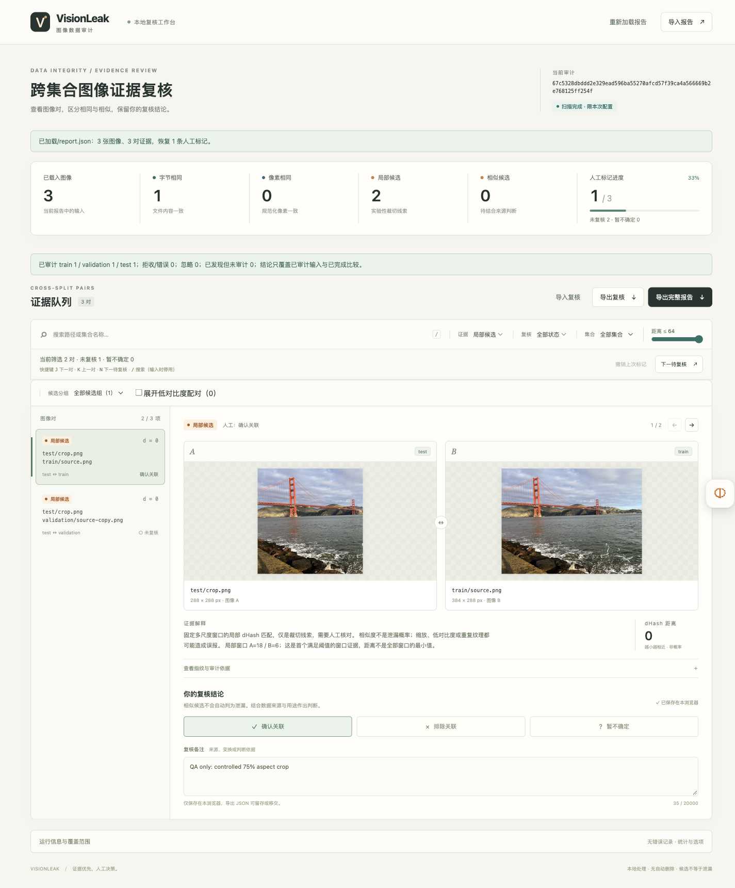

# VisionLeak

[](https://github.com/cjyhjy/moonbit-visionleak/actions/workflows/ci.yml)

本地、可复核的图像数据集重复审计与 CI 关卡：区分确定性重复和相似线索，说明检查覆盖范围，离线移交证据与复核记录。



```sh
npm ci
node tools/cli.mjs audit --root fixtures/benchmark --out output/example --fail-on pixel
node tools/server.mjs --report output/example/report.json --port 4173
```

演示数据含确定性重复，第二行预期退出 **3**；CI 可据此阻止跨集合重复。浏览器打开 http://127.0.0.1:4173 。需要 Node.js 22+，CLI 已附带编译后的 MoonBit 核心。

**当前工作区为 0.7.0 本地候选版本，尚未公开发布。** [本轮改进与迁移](docs/changes-0.7.0.md) · [本地验收](reports/post-review/README.md)。

已发布 0.6.0 的完整变更见 [版本说明](docs/changes-0.6.0.md) 和 [CHANGELOG](CHANGELOG.md)。发布与验收状态以 [发布记录](reports/plan-0.6.0/publication/README.md) 为准；Mooncakes 模块为 `cjyhjy/visionleak`。

下游集成可用 `node tools/cli.mjs capabilities` 查询实际版本、参数预算和复验范围；升级依赖时固定提交与产物摘要。

## 证据与可移交输出

| 等级 | 依据 | 使用方式 |
|---|---|---|
| 字节相同 | 原文件 SHA-256 | 确定性重复，可作为 CI 关卡 |
| 像素相同 | EXIF/sRGB/白底规范化后的完整尺寸和 RGB 摘要 | 编码可不同，仍可作为确定性关卡 |
| 感知候选 | 全图 dHash，可选镜像及直角旋转 | 人工复核 |
| 局部候选 | 默认关闭的 20 窗口局部 dHash | 实验性裁切线索，人工复核 |

`verify` 重新读取文件核对确定性证据；`export-html` 导出单文件离线报告；`export-fixes` 导出修正建议 CSV 和稳定组键。工具不删除或移动数据。

```sh
node tools/cli.mjs verify --report output/example/report.json --root fixtures/benchmark
node tools/cli.mjs export-html --report output/example/report.json --out evidence.html
node tools/cli.mjs export-fixes --report output/example/report.json --out suggestions.csv
```

## 现有数据接入与演示

```sh
node tools/cli.mjs audit --root /path/to/images --manifest splits.csv --out output/manifest --cache .cache/fingerprints
node tools/demo-walkthrough.mjs output/walkthrough-v070
```

清单使用 `path,split` 表头，路径相对 root，支持 CSV 引号和 split 别名。报告绑定清单摘要；缓存按内容和指纹配置失效，命中仍运行全部比较。工作台展示各阶段完成度，并提供默认关闭的实验复核排序。完整演示的复核记录由脚本构造并明确标注，不代表真人复核实验。

## 数据与验证

MoonBit 负责指纹、索引、预算、证据等级、报告身份和建议规则；Node/sharp 负责解码与 I/O。Python ImageHash 和独立集合指标用于外部核对。

0.5.0 使用 32 个 CC0 文件来源，按来源和场景分为 16 个开发来源、16 个当时的新保留来源；连同原有 10 张照片，现均作为已知回归数据，不是 0.6.0 的新独立测试集。[来源与许可](research/photos-v2/ATTRIBUTION.md) · [裁切评测](reports/plan-0.5.0/crops-holdout/evaluation.json) · [规模测试](reports/plan-0.5.0/scale-phase3-final/results.json)。

```sh
python3.13 tools/bootstrap.py
npm run build
npm run verify:ci
```

0.7.0 新增 12 个 CC0 文件来源，先冻结规则再下载图像，包含随机偏移裁切、水印、截图边框和同场景负例。[来源与许可](research/photos-v3/ATTRIBUTION.md) · [本轮评测](reports/post-review/photos/evaluation.json)。

## 局限

- 感知和局部结果均可误报。0.5.0 当时的新保留组局部候选 TP=117、FP=44、FN=59；不据此自动删除文件或证明泄漏。
- 照片评测是受控变换。旧评测部分裁切与固定窗口对齐；0.7.0 使用预先冻结规则的随机偏移裁切。两者均不能推算自然污染率或真人复核耗时。
- 预算耗尽和输入拒收使 `complete=false`；结论只覆盖已完成范围。0.6.0 的 5,000 图合成测试中默认、镜像已完成，旋转及裁切仍耗尽预算。0.7.0 将确定性和近似阶段预算分开，详见迁移说明。
- 像素摘要覆盖全分辨率；sharp 仍会完整解码 RGBA。默认解码上限 64MP，最大 100MP；感知取样上限另设。
- 摘要一致基于 SHA-256 通常的碰撞假设，规范化像素一致不等于原始像素编码逐位相同。

[CLI 手册](docs/cli.md) · [API](docs/api.md) · [架构](docs/architecture.md) · [复核教程](docs/demo.md) · [复现](docs/reproducibility.md) · [来源和 AI 辅助](docs/development.md) · [MIT 许可证](LICENSE) · [第三方许可](THIRD_PARTY.md)

0.6.0 索引、内存与复核改进：[实现、验证与性能边界](docs/optimization.md)。
